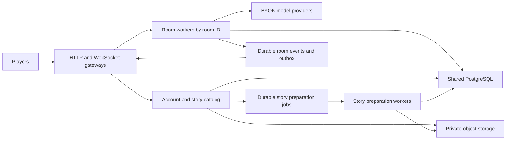

# ADR-0010 Scale out gameplay and story preparation independently

- Status: Adopted design. Single-host baseline and opt-in PostgreSQL and object-storage staging are implemented. The room worker and gateway split is available for staging. Staging capacity validation is pending.
- Date: 2026-11-18
- Related: ADR-0001 RoomStorage, ADR-0002 shared solo and multiplayer protocol, ADR-0007 dossier authority and spoiler protection

## Context

The initial deployment runs REST, WebSockets, room execution, and story preparation in one Node process. SQLite holds account data, room snapshots, and story metadata. Sources and prepared artifacts live on local disk. The original deployment target was up to 100 active rooms. The new planning target is thousands of simultaneously connected players and playing rooms, with millions of private story records across owners. Capacity depends on per-room action rates, story size, provider latency, and import volume.

## Target topology

### Room execution

An active instance is a single writer for its room. Route every command, including membership changes and room settings, through the room's worker. Gateways own their client sockets and subscriptions. Shared account and invite lookup lets participants connect through any gateway. Preserve the room's original story owner and the current host's BYOK identity.

Store room ownership and a monotonically increasing ownership epoch in PostgreSQL. Gate all durable state transitions on that epoch so a worker that has lost ownership cannot commit a late result. Persist an accepted action and its idempotency key before acknowledging it. Commit each turn's state and sequenced events together, with a durable outbox for fan-out. A new worker restores from the last committed state and resumes accepted work. Provider requests may be repeated after an interruption. Action and turn identifiers prevent repeated commits of rule effects.

Keep hot state and a bounded recent event window in the worker. Store transcript history separately from the room's hot snapshot. Catch up clients by sequence after reconnection, with a bounded snapshot for old cursors. Treat gateway restart as transport loss so a rollout cannot masquerade as a player leaving.

### Story catalog and preparation

Use tenant-scoped, cursor-paged metadata in PostgreSQL and private object storage for source files and prepared artifacts. Look up by owner, story ID, and artifact revision. Pin a coherent source and prepared artifact revision for each room. A preparation worker publishes a completed revision only after all required objects are available. Existing rooms can continue using their pinned revision.

Run OCR, indexing, and dossier generation in a durable job queue with independent worker concurrency, retry budgets, deduplication, and backpressure by account. A PostgreSQL job table and outbox can support the first multi-host deployment. Measure contention before selecting a dedicated broker. Keep retrieval scoped to the selected story. A global vector index would serve a separate cross-story search feature.

### Overload and operation

Budget active and queued Keeper work separately from imports, with provider-level deadlines and backoff. Measure connection count, active rooms, turn queue wait, provider latency, p95/p99 action echo and catalog latency, event-loop delay, database pressure, memory, and recovery time. Run sustained play, import bursts, cold-cache reads, reconnect spikes, and worker-loss tests on the intended deployment. Use short controlled live-provider runs to measure BYOK latency and quota behavior.

## Implemented first stage

- The existing SQLite deployment runs one gameplay process. Opt-in local child processes execute story indexing and dossier generation, one process per admitted job. Overload returns a retryable response, and the existing operation ID and progress frames continue to work. Interruptions require client retry.
- The story artifact location index resolves known UUID paths directly. Legacy files remain readable. Writes replace complete JSON files atomically. Reveal checks reject mismatched dossier and anchor revisions, and loaded index and dossier caches have size budgets.
- The stories endpoint has a paged form alongside the compatibility array. Room membership and stories have indexes for owner-scoped operations.
- The room runtime bounds active instances, per-room queued actions, and concurrent Keeper turns. It batches concurrent turn snapshot commits, skips periodic writes for unchanged state, and releases retired subscription entries. The server detaches a WebSocket that exceeds the inbound message or outgoing send-buffer limit. These two server-imposed cutoffs clear subscriptions and preserve room ownership. Ordinary disconnects and explicit leaves retain ADR-0005's room governance.

## Shared staging

Two HTTP gateways can share [sign-in and private account settings](../DEPLOYMENT.md#61-双网关账号预发布环境113) in PostgreSQL and an [owner-scoped story catalog](../DEPLOYMENT.md#62-双网关私有剧本目录114) with private object storage. An independent [story preparation worker](../DEPLOYMENT.md#64-共享剧本准备进程116) can recover an interrupted job and publish a complete revision. Story owners can see progress through either gateway.

The opt-in [shared room staging process](../DEPLOYMENT.md#63-单进程共享房间预发布115) keeps one authoritative gameplay process, stores rooms and membership in PostgreSQL, and restores solo and multiplayer rooms over the existing protocol. With [shared story preparation and storage enabled](../DEPLOYMENT.md#65-共享房间固定剧本版本118), each new room pins the verified source and preparation revisions. Saved rooms retain access to those revisions after regeneration or catalog deletion. Fixture-only staging uses prepared files under a separate root.

A separate opt-in [worker failover stage](../DEPLOYMENT.md#多房间进程故障恢复预发布120) gives each active room a renewable PostgreSQL lease and a monotonic epoch. It restores the accepted batch and fences turn results, state, room events, and outbox rows in one commit. It supports direct worker connections or separate HTTP and WebSocket gateways. The gateways route authenticated room commands to the worker and deliver committed events in sequence. Gateways replay recent events directly from the committed sequence in PostgreSQL. Workers scan a bounded, indexed set of expired leases for pending turns so replay can restore the connection even before a replacement claims the room. Workers retain the latest 200 event sequences and archive transcript messages separately. An expired or incomplete cursor, or a replay above 512 KiB, receives a snapshot with at most 40 messages and a transcript cursor. SQLite cutover remains a later rollout stage.

## Local capacity check

On November 18, the synthetic smoke opened 1,000 playing rooms over 1,000 WebSockets and seeded 1,000,000 story metadata rows. It completed three rounds of one mock Keeper turn per room.

| Action pattern | Player echo p95 | Mock Keeper reply p95 |
|---|---:|---:|
| 1,000-action burst before snapshot batching | 15.364 s | 15.378 s |
| 1,000-action burst after snapshot batching | 2.811 s | 11.488 s |
| 1,000 actions over 15 seconds per round after batching | 81 ms | 948 ms |

The run exercised a paged catalog read per round. It used one local Windows host, short transcripts, synthetic metadata and a mock Keeper. It provides a repeatable single-host smoke workload. Target deployment acceptance requires sustained mixed traffic and live-provider and failure tests.

### Reproduction for #112

A second local Windows run on November 18 completed all 3,000 mock turns in each workload against 1,000 playing rooms and 1,000,000 story metadata rows. The harness pinned 16 concurrent Keeper turns and disabled Keeper chunk streaming.

| Action pattern | Player echo p95 | Mock Keeper reply p95 | Catalog page p95 |
|---|---:|---:|---:|
| 1,000 actions over 15 seconds per round | 1.141 s | 2.274 s | 3.430 s |
| 1,000-action burst | 3.852 s | 12.137 s | 4.051 s |

Each catalog p95 comes from only three page reads. Latency varied between local runs. The transport reset regression tests independently exercise inbound and outbound size limits.

## Rollout

1. Deploy the single-host stage with a matched backup of SQLite and the artifact directories. Set per-host limits from staging measurements and use the readiness and liveness endpoints.
2. Add PostgreSQL and object storage adapters and validate transfer of existing users, owner-scoped stories, and room state. Move list consumers to paged catalog reads. Switch preparation to durable jobs and publish immutable artifact revisions.
3. Add gateways and fenced room workers. Test two-host ordering, duplicate action submission, worker loss mid-turn, replay, and rolling upgrades before routing live traffic to multiple gameplay instances.

The single-host stage retains full room history in snapshots. Catalog pages address story metadata. Source bytes, derived artifacts, live providers, long sessions, and cross-host recovery need independent capacity and fault tests.
